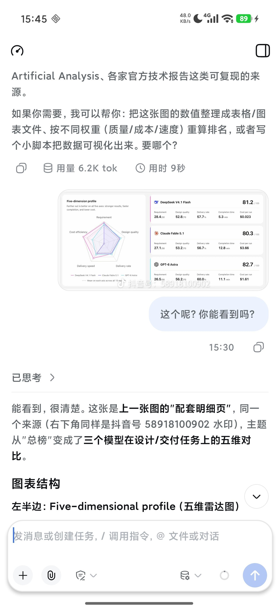
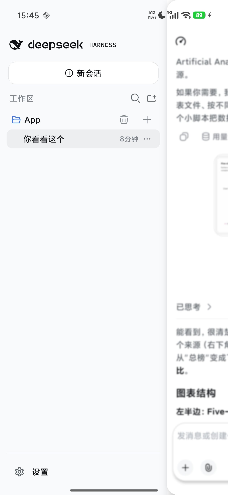
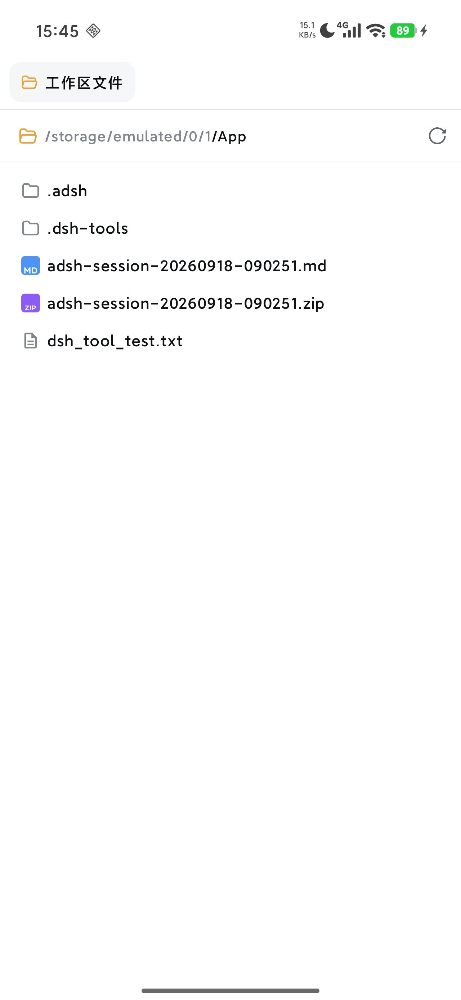
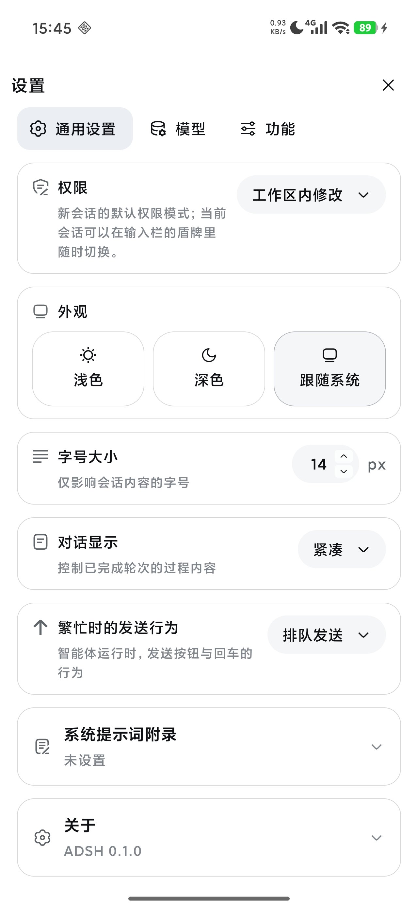

# ADSH

目前移动端deepseek Harness 有三种路径，其一是轻量的远程连接app，仅操控，无法脱离电脑；其二是强行把dsh在手机上本地运行，启动麻烦且慢，同时由于dsh没有做移动端适配，导致UI体验非常差；其三就是本项目，说是dsh mobile但实际上已经脱离了dsh，且算是一款新应用，舍弃了在手机上无用的工具、dsh的核心—插件化等功能与特性，换来了秒启动与舒适的UI体验，算是性价比dsh—mobile。

ADSH 是把 DeepSeek Harness（dsh）搬到 Android 上的原生实现：沿用 dsh 的 PTC 工具语义，界面按 DeepSeek App / dsh 的视觉规范校准，但不带 Node 运行时、不加载插件、不在运行期下载任何东西 —— 装好打开就能用。

## 它是什么

界面是 Kotlin + Jetpack Compose 的单 Activity。对话流、输入区、抽屉、文件预览和设置都照着 dsh 与 DeepSeek App 的样子做，同时补了一些手机上更趁手的东西：右侧可拖的滚动条、双击刘海回到会话开头、docx / xlsx / pptx / pdf / 图片的本地预览，以及面向长会话的流式渲染与行级绘制裁剪。

工具层是 dsh 原版那一套：`bash`、`read`、`read_image`、`write`、`edit`、`glob`、`grep`、`todo_write`、`present`、`web_search`、`web_fetch`、`ask_user_question`、`exit_plan_mode` 共 13 个，加上 `run_code` 一共 14 个。模型能直接调用的只有 `run_code` —— 其余工具在系统提示词的 `tools:sdk` 段里声明，由程序用 `await tools.<name>(args)` 组合调用（PTC / QuickJS）。`ToolCallError` 与输出 schema 都对着 dsh 源码核过。

运行环境是内嵌的 Termux 用户态：bootstrap 静态打进 APK，前缀就是官方前缀 `/data/data/com.termux/files/usr`，所以 `bash` 和随包分发的 CLI 直接就能跑，不需要 root 或 proot。工作区用 SAF 选目录，重活可以放到 `$ADSH_SCRATCH`。模型侧支持官方 DeepSeek（含原生多模态）和常见供应方目录，填个密钥即可。

## 截图

<p align="center">
  
  
  
  
</p>

## 安装

下载 [`ADSH-0.2.4-release.apk`](https://github.com/yuyuyuyulike/ADSH/releases/download/v0.2.4-20261018/ADSH-0.2.4-release.apk)：arm64-v8a，Android 8.0（API 26）以上；release 已开 R8（minify + shrink）。新版本都发在 [Releases](https://github.com/yuyuyuyulike/ADSH/releases) 页，那里始终是最新那一份。

> **不能与官方 Termux 共存**：本应用的包名就是 `com.termux`（Termux 的前缀路径编译死在二进制里，官方明确「安装后不可重定位」）。装之前要先卸载官方 Termux，反之亦然；两者共用同一个数据目录，卸载本应用等于清空内置用户态。

## 手机上怎么放东西

- **工作区**（你绑定的文件夹）在 Android 外部存储上：只能读写普通文件 —— 建不了软链、置不了执行位、不能执行里面的文件，适合放素材与最终产物。
- **重活**（`npm install` / 构建 / git）放到 `$ADSH_SCRATCH`（= `$HOME/scratch`），做完把产物拷回工作区；`$ADSH_WORKSPACE` 始终指向当前工作区，`/tmp` 就是 `$TMPDIR`。
- `targetSdk` 有意钉在 28（与官方 Termux 一样，见 [HANDOFF.md](HANDOFF.md)）：代价是上不了 Google Play，本项目只走 GitHub Release 侧载。

## 构建

JDK 17 + Android SDK 37 + NDK 28；先跑 `scripts/prepare-assets.sh` 备好随包资源（`assets/bootstrap/*.zip`、`execLibs/librg.so` / `libbash.so`，都在 `.gitignore` 里，且必须原样复制）。

```bash
cmd.exe /c "scripts\build-debug.bat :app:testDebugUnitTest :app:assembleRelease"
```

实现细节、平台约束与有意偏离 dsh 的地方见 [HANDOFF.md](HANDOFF.md)；每个版本的变更见 [CHANGELOG.md](CHANGELOG.md)。

## 许可

MIT
